  

  &nbsp;&nbsp;
  &nbsp;&nbsp;
  

 

  <b>Senior AI Solution Architect @ InvenTel</b> (New Jersey, USA) · remote from Karachi 🇵🇰 
  15+ years shipping software. Today I design the <b>agents, RAG systems and LLM platforms</b> companies put in front of real users — and the cloud architecture that keeps them fast, cheap and observable. 
  Co-founder of <a href="https://meetactionmind.com/"><b>ActionMind AI</b></a> · BS IT, NUST · AWS &amp; Google Cloud certified · I write about building with AI on <a href="https://www.linkedin.com/in/panhwerwaseem/">LinkedIn</a>.

 

  

 

  

 

  

 

  
  

<picture>
  <source media="(prefers-color-scheme: dark)" srcset="https://raw.githubusercontent.com/panhwerwaseem/panhwerwaseem/output/github-snake-dark.svg">
  <source media="(prefers-color-scheme: light)" srcset="https://raw.githubusercontent.com/panhwerwaseem/panhwerwaseem/output/github-snake.svg">
  
</picture>

 

  

