<!-- ═══════════════════════ HERO ═══════════════════════ -->

  

  

  

  &nbsp;
  &nbsp;
  &nbsp;
  

 

<!-- ═══════════════════════ ABOUT ═══════════════════════ -->

<table border="0" width="100%">
<tr>
<td width="60%" valign="top">

## ⚡ Who I am

I'm **Muhammad Waseem Panhwar** — a **Senior AI Solution Architect at InvenTel** (New Jersey, USA), working remotely from Karachi 🇵🇰.

After **15+ years** of shipping software — from team lead to associate architect — I now spend my days designing the AI systems that companies actually put in front of customers: **multi-agent workflows, retrieval pipelines, LLM platforms** and the **cloud architecture** that keeps them fast, cheap and observable.

- 🚀 Co-founder of **[ActionMind AI](https://meetactionmind.com/)** — an AI teammate that joins your meetings and turns talk into executed tasks
- 🎓 BS IT, **NUST** · certified in **AWS**, **Google Cloud**, **Generative AI**, project management
- ✍️ I publish daily on [LinkedIn](https://www.linkedin.com/in/panhwerwaseem/) about building with AI
- 🧑‍🏫 I mentor engineers on agentic RAG (LangChain · LangGraph · FastAPI) and consult on AI architecture

</td>
<td width="40%" valign="top" align="center">

</td>
</tr>
</table>

 

<!-- ═══════════════════════ HOW I BUILD ═══════════════════════ -->
<h2 align="center">🧠 How I build AI that ships</h2>

  

<table border="0" width="100%">
<tr>
<td width="33%" valign="top">

### 🤖 AI Agents
Tool-using, multi-step agents with **LangGraph**, **MCP servers**, function calling and human-in-the-loop controls. Agents that are evaluated, traced and safe to run unattended.

</td>
<td width="33%" valign="top">

### 📚 RAG Systems
Hybrid search, smart chunking, **pgvector / Pinecone / Qdrant**, re-ranking and grounded answers with citations — built for accuracy, not demos.

</td>
<td width="33%" valign="top">

### ☁️ Cloud Architecture
Event-driven and microservice designs on **AWS** and **GCP**; API design, scaling, cost control, observability and security.

</td>
</tr>
</table>

 

<!-- ═══════════════════════ STACK ═══════════════════════ -->
<h2 align="center">🧰 Stack</h2>

  

  
  
  
  
  
  
  
  

 

<!-- ═══════════════════════ FEATURED ═══════════════════════ -->
<h2 align="center">🚀 Featured work</h2>

<table border="0" width="100%">
<tr>
<td width="50%" valign="top">

**ActionMind AI** — AI joins the meeting, captures decisions, creates tasks and executes the API-doable ones automatically. Live at [meetactionmind.com](https://meetactionmind.com/).
</td>
<td width="50%" valign="top">

**🔗 AI Internal-Linking Dashboard** — LLM-powered engine that maps a site's content graph and recommends internal links for SEO at scale.

**🧩 Agentic RAG Reference Build** — LangChain + LangGraph + FastAPI starter I use for teaching and client delivery: hybrid retrieval, tool routing, evals.

**📊 Engineering Performance Intelligence** — GitHub-driven system that turns commit & PR data into team performance insight.
</td>
</tr>
</table>

 

<!-- ═══════════════════════ STATS ═══════════════════════ -->
<h2 align="center">📈 Activity</h2>

  
  

  

  

<picture>
  <source media="(prefers-color-scheme: dark)" srcset="https://raw.githubusercontent.com/panhwerwaseem/panhwerwaseem/output/github-snake-dark.svg">
  <source media="(prefers-color-scheme: light)" srcset="https://raw.githubusercontent.com/panhwerwaseem/panhwerwaseem/output/github-snake.svg">
  
</picture>

 

<!-- ═══════════════════════ CONNECT ═══════════════════════ -->
<h2 align="center">🤝 Let's build something</h2>

  Open to <b>AI architecture consulting</b>, <b>agent &amp; RAG builds</b>, <b>advisory</b> and <b>speaking</b>.

  
  

  

